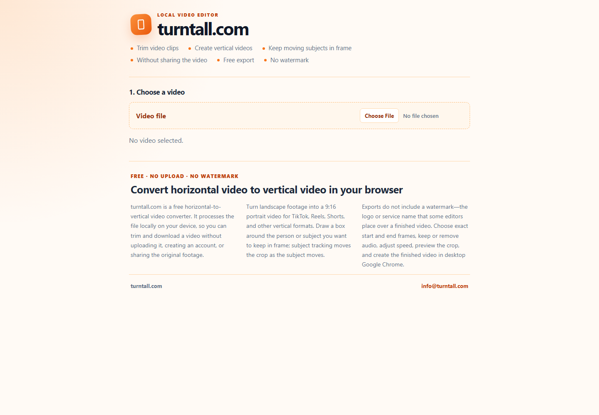
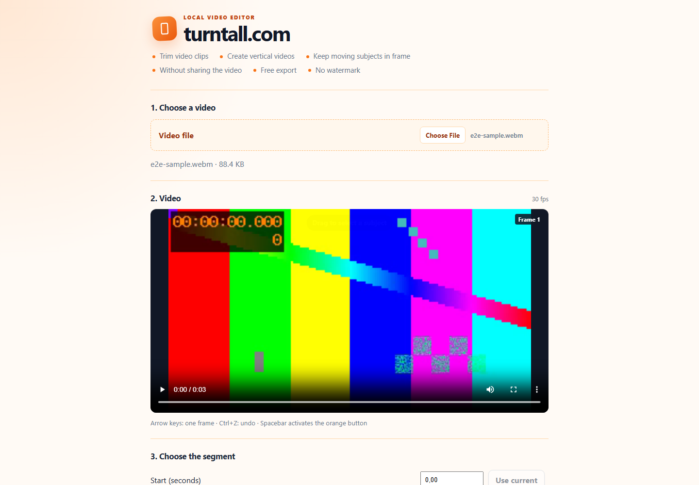

# turntall.com

Turn landscape video into polished 9:16 clips—privately, in your browser.

[**Open turntall.com**](https://turntall.com/) · Free · No account · No upload · No watermark



turntall.com is a local-first video editor for trimming clips and keeping a
moving subject centered in a vertical frame. Your source video stays on your
device: editing, tracking, previewing, and export all happen locally.

## What you can do

- Trim a video to exact start and end times.
- Convert landscape footage to a centered 9:16 vertical video.
- Draw a box around a person or object and track it through the clip.
- Correct the subject position after large movements or scene changes.
- Keep or remove audio and change playback speed from 0.5× to 3×.
- Preview the crop before exporting.
- Download the result without an account or watermark.

The web app currently supports desktop Google Chrome. Mobile visitors receive a
recommendation to continue on a desktop computer.

## How to use it

1. Open [turntall.com](https://turntall.com/) in desktop Google Chrome.
2. Choose a video from your device.
3. Set the segment you want to keep.
4. Optionally enable **9:16 vertical video**. For a moving crop, pause on a
   clear frame and drag a box around the subject, then use **Track**.
5. Preview the result, choose audio and speed options, and create the video.
6. Name and download the finished file.



For precise placement, use the Left and Right Arrow keys to move one real video
frame at a time. The Spacebar activates the current orange subject-selection or
tracking action. If tracking loses confidence or finds a scene change, it stops
so you can redraw the box and continue.

## Privacy and local processing

Video files are not uploaded to turntall.com or sent to a server. The app uses
FFmpeg WebAssembly, Mediabunny, and native WebCodecs to inspect and process media
inside the browser. Old preview URLs, temporary processing files, and obsolete
conversion workers are released when they are no longer needed.

Files larger than 1 GiB use the streaming path so a multi-gigabyte video is not
read into a single browser `ArrayBuffer`. Compatible cuts can copy the original
streams without quality loss; exact cuts, moving crops, vertical output, and
speed changes are re-encoded.

## Run locally

### Requirements

- [Node.js](https://nodejs.org/) 24 is preferred; 22.12 or newer is supported.
- npm (the checked-in `package-lock.json` is the source of truth).
- Desktop Google Chrome for manual browser testing.

```sh
npm install
npm run dev
```

Open the local address printed by Vite.

To run the Playwright browser tests, install the bundled Chromium build once:

```sh
npx playwright install chromium
npm run test:e2e
```

## Development commands

| Command | Purpose |
| --- | --- |
| `npm run dev` | Start the Vite development server |
| `npm test` | Run unit tests once |
| `npm run test:watch` | Run unit tests in watch mode |
| `npm run test:coverage` | Run unit tests with coverage |
| `npm run test:e2e` | Run the Playwright workflows |
| `npm run test:e2e:headed` | Run Playwright with a visible browser |
| `npm run test:e2e:production` | Test the production bundle |
| `npm run typecheck` | Check TypeScript |
| `npm run check:svelte` | Check Svelte components |
| `npm run build` | Create a production build |
| `npm run check` | Run the normal completion gate |

`npm run check` runs unit tests, TypeScript diagnostics, Svelte diagnostics,
and the production build.

## Project structure

```text
src/
├── app/          Application shell and global styles
├── components/   Svelte layout, dialogs, and editor panels
├── editor/       Browser UI orchestration and editor state
├── media/        Media probing, formats, streaming, and frame scheduling
├── platform/     Browser capability checks
├── processing/   FFmpeg and WebCodecs conversion pipelines
└── tracking/     Subject geometry, tracking, scene detection, and crop paths
```

Framework-independent logic is covered by focused Vitest suites under
`tests/`. Complete browser workflows live under `e2e/` and use the small,
deterministic `tests/fixtures/e2e-sample.webm` fixture.

The Svelte components own the page structure, while `src/editor/controller.ts`
still owns much of the mounted editor state and updates stable DOM bindings from
`src/editor/ui.ts`. Treat element IDs, JavaScript-facing classes, control values,
and important `hidden` attributes as application APIs when changing components.

## Deployment

For crawler-visible HTML, Markdown negotiation, trust pages, and real HTTP 404s,
see the [agent readiness release guide](docs/agent-readiness.md). It includes
the production rollout order and an endpoint verification command.

GitHub Actions builds the production app and deploys it to a private Amazon S3
bucket behind CloudFront. AWS access uses GitHub OIDC, so the repository does
not store permanent AWS access keys. Infrastructure and setup instructions are
in [`terraform/`](terraform/README.md).

The production build also publishes `robots.txt`, `sitemap.xml`, and `llms.txt`
from `public/`. Keep their product claims aligned with the visible page copy and
the JSON-LD metadata in `index.html`.
